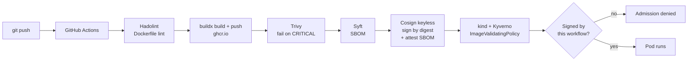

# secure-supply-chain-pipeline

> **Status: work in progress.** Built phase by phase; see [Roadmap](#roadmap).

## The problem

Anyone who can push an image to a registry can make a cluster run it. Tags are mutable, base images carry known CVEs, and nothing proves that the image running in production came from your CI and not from a laptop or a compromised account.

## The outcome

A reproducible, end-to-end secure software supply chain for a small sample app, from source to a running pod, where the cluster **only runs images that were built and signed by this repository's GitHub Actions workflow**:

- an **unsigned** image is **rejected** by the admission controller
- an image **signed by this workflow** is **allowed** and runs

Everything runs on free tooling (public GitHub repo, GHCR, a local kind cluster).

## Pipeline flow



Signing is keyless: the workflow's GitHub OIDC token is exchanged for a short-lived Fulcio certificate, and the signature is recorded in the Rekor transparency log. Images are signed by digest, never by tag.

## Planned stack

| Concern | Tool |
|---|---|
| CI | GitHub Actions |
| Registry | GHCR |
| Dockerfile lint | Hadolint |
| Vulnerability scan | Trivy |
| SBOM | Syft (SPDX / CycloneDX) |
| Signing and attestation | Cosign / Sigstore (keyless) |
| Local cluster | kind |
| Admission policy | Kyverno `ImageValidatingPolicy` |

Tool versions and maintenance status will be listed here once each tool is wired in.

## Roadmap

- [x] Phase 1: sample app, multi-stage non-root Dockerfile, Hadolint, build and push to GHCR
- [ ] Phase 2: Trivy scan, Syft SBOM
- [ ] Phase 3: Cosign keyless signing, SBOM attestation, kind + Kyverno, `ImageValidatingPolicy`
- [ ] Phase 4: blocked vs allowed demo, architecture docs, results, lessons learned

## Local build

Prerequisites: Docker, [Hadolint](https://github.com/hadolint/hadolint) (v2.15.1 used) and Go (only to run the app tests).

```bash
# 1. Lint the Dockerfile (same config as CI)
hadolint --config .hadolint.yaml Dockerfile

# 2. Run the unit tests
(cd app && go test ./...)

# 3. Build and run the image
docker build --build-arg VERSION=local -t ssc-app:local .
docker run --rm -p 8080:8080 ssc-app:local

# 4. In another terminal
curl localhost:8080/version   # {"version":"local"}
curl localhost:8080/healthz   # ok
```

The image is built in two stages and the final stage is `scratch`, running as the non-root user `65532`.

## Published image

On every push to `main`, CI builds a multi-arch image (`linux/amd64`, `linux/arm64`) and pushes it to GHCR. Pull requests are built but not pushed.

```bash
docker pull ghcr.io/vigneshwaraprabu/secure-supply-chain-pipeline:latest
```

Tags: `latest`, `main` and `sha-<full commit SHA>`. Tags are mutable, so later stages sign and verify the image by **digest**, which is printed in each run's job summary.

## Vulnerability scanning

After the image is pushed, CI scans it **by digest** with [Trivy](https://github.com/aquasecurity/trivy) (v0.76.2):

1. A full report (all severities) is uploaded as SARIF to the repository's **Security → Code scanning** tab.
2. A gate step fails the pipeline if any vulnerability at the configured severity has a fix available.

| Setting | Default | How to change |
|---|---|---|
| Failing severity | `CRITICAL` | Repository variable `TRIVY_FAIL_SEVERITY`, e.g. `HIGH,CRITICAL` |
| Unfixed vulnerabilities | ignored by the gate | `ignore-unfixed` in the workflow |

Because the scan runs after the push, a failing image still exists in GHCR, but signing (Phase 3) only runs after a passing scan, so the cluster policy will refuse it.

Run the same scan locally:

```bash
trivy image --severity CRITICAL --ignore-unfixed \
  ghcr.io/vigneshwaraprabu/secure-supply-chain-pipeline:latest
```

## Scope

This is a **demo / portfolio project**, not a production-ready platform. Production concerns such as multi-cluster policy rollout, key and identity governance, exception handling and monitoring are out of scope. This will be stated per component as it is built.
