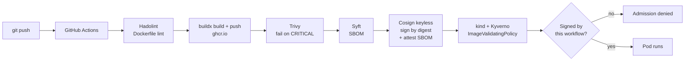

# secure-supply-chain-pipeline

> **Status: work in progress.** Built phase by phase; see [Roadmap](#roadmap).

## The problem

Anyone who can push an image to a registry can make a cluster run it. Tags are mutable, base images carry known CVEs, and nothing proves that the image running in production came from your CI and not from a laptop or a compromised account.

## The outcome

A reproducible, end-to-end secure software supply chain for a small sample app, from source to a running pod, where the cluster **only runs images that were built and signed by this repository's GitHub Actions workflow**:

- an **unsigned** image is **rejected** by the admission controller
- an image **signed by this workflow** is **allowed** and runs

Everything runs on free tooling (public GitHub repo, GHCR, a local kind cluster).

## Pipeline flow

Signing is keyless: the workflow's GitHub OIDC token is exchanged for a short-lived Fulcio certificate, and the signature is recorded in the Rekor transparency log. Images are signed by digest, never by tag.

## Planned stack

| Concern | Tool |
|---|---|
| CI | GitHub Actions |
| Registry | GHCR |
| Dockerfile lint | Hadolint |
| Vulnerability scan | Trivy |
| SBOM | Syft (SPDX / CycloneDX) |
| Signing and attestation | Cosign / Sigstore (keyless) |
| Local cluster | kind |
| Admission policy | Kyverno `ImageValidatingPolicy` |

Tool versions and maintenance status will be listed here once each tool is wired in.

## Roadmap

- [ ] Phase 1: sample app, multi-stage non-root Dockerfile, Hadolint, build and push to GHCR
- [ ] Phase 2: Trivy scan, Syft SBOM
- [ ] Phase 3: Cosign keyless signing, SBOM attestation, kind + Kyverno, `ImageValidatingPolicy`
- [ ] Phase 4: blocked vs allowed demo, architecture docs, results, lessons learned

## Scope

This is a **demo / portfolio project**, not a production-ready platform. Production concerns such as multi-cluster policy rollout, key and identity governance, exception handling and monitoring are out of scope. This will be stated per component as it is built.
